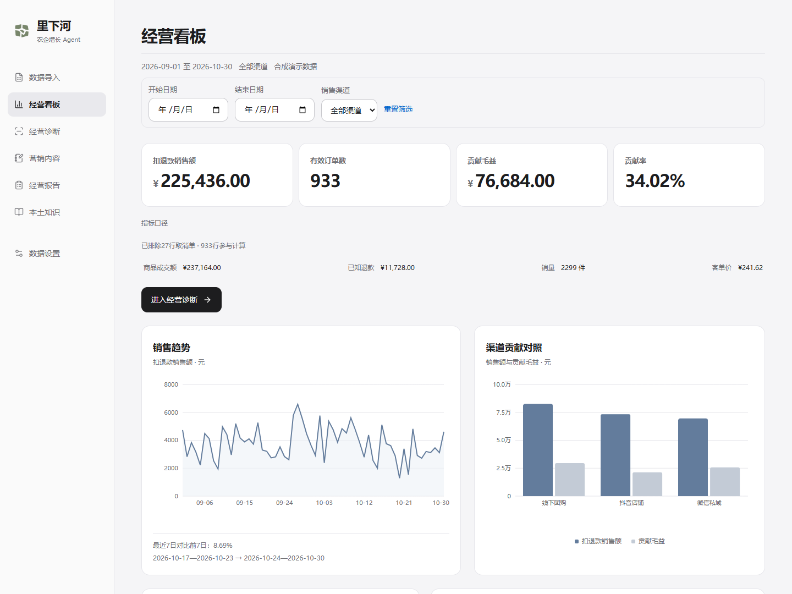
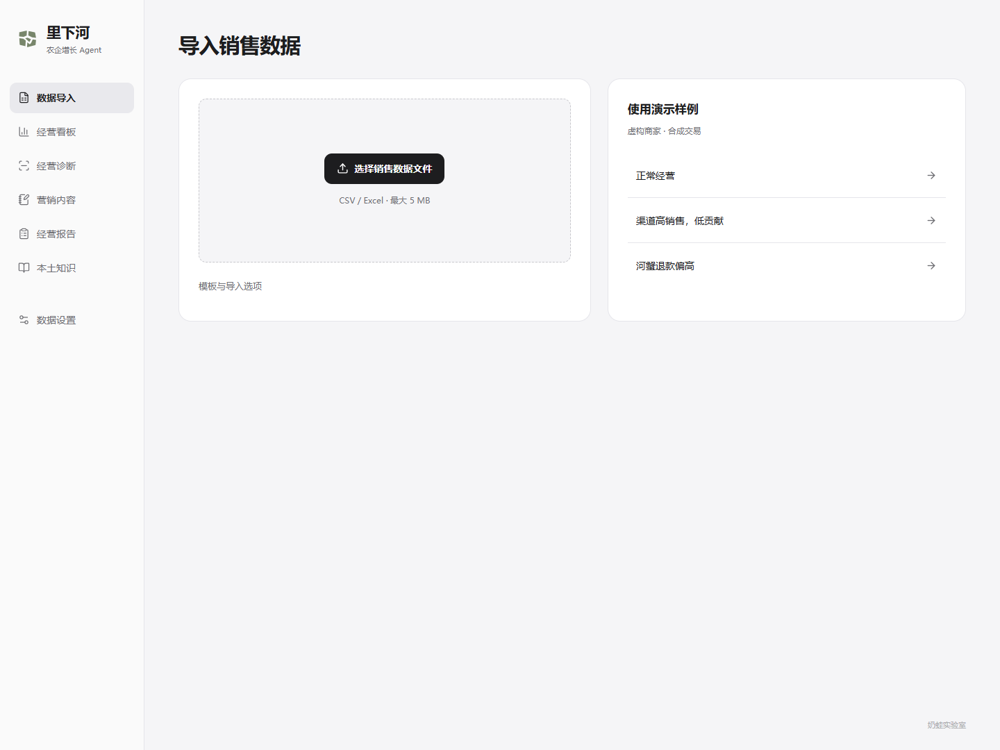
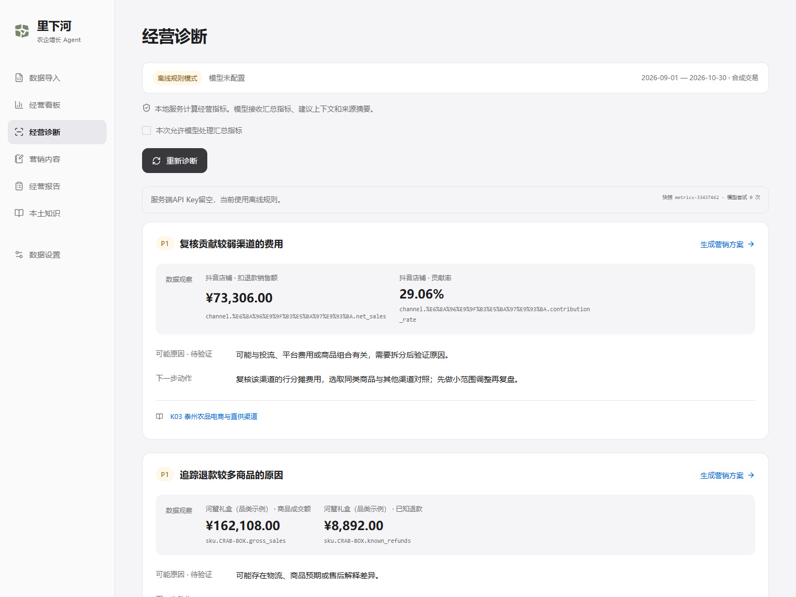
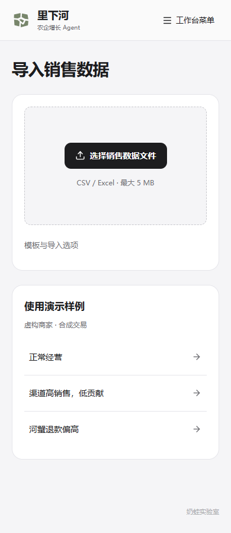

# 里下河 · 农企增长 Agent

面向泰州农企与农特产品经营场景的本地工作台。导入销售表，核对销售、成本与渠道贡献，再把经营诊断整理成营销草稿和复盘报告。

**CSV / Excel 导入 · 经营看板 · 经营诊断 · 营销内容 · 本土知识 · 报告导出**

## 产品界面

新版采用中性浅色控制台：浅灰背景、白色面板、石墨黑主按钮与少量蓝色强调。灰橄榄绿的垛田标志保留兴化田块与水道的轮廓，桌面和手机沿用同一套组件与数据口径。

以下均为当前版本实际运行截图，使用内置合成演示数据。

### 经营看板

四项关键指标、销售趋势与渠道贡献同屏呈现。筛选日期或渠道后，看板、诊断和报告使用当前统计范围。



### 数据导入

选择 CSV / Excel 或载入三类演示样例，完成字段映射与质量检查后进入分析。



### 经营诊断

诊断结果区分数据观察、待验证原因和下一步动作，并保留指标引用与本土知识来源。



### 手机界面

手机端纵向排列上传和样例入口，工作台菜单按需展开。看板优先展示渠道贡献；宽表可在表格区域内横向查看，金额与百分比保持完整。



## 能做什么

| 工作台   | 能完成的任务                                                                              |
| -------- | ----------------------------------------------------------------------------------------- |
| 数据导入 | 导入 CSV、Excel，映射字段、检查异常行；提供正常经营、渠道低贡献、河蟹高退款三类合成样例。 |
| 经营看板 | 查看扣退款销售额、有效订单数、贡献毛益与贡献率，按日期和渠道筛选，比较商品与渠道表现。    |
| 经营诊断 | 展示经营指标依据、可能原因、行动建议和来源；未配置模型时使用离线规则。                    |
| 营销内容 | 核对商品事实，生成并编辑短视频脚本、商品文案、社交文案和七日行动清单，支持复制。          |
| 经营报告 | 汇总当前范围的数据、诊断和已编辑草稿，下载 Markdown、HTML、CSV，或打印为 PDF。            |
| 本土知识 | 按品类阅读泰州农业、渠道和物流资料，查看来源、发布机构与核验日期。                        |

## 本机快速体验

环境要求：**Node.js 24、pnpm 11.25.0**。

```sh
git clone https://github.com/ray404butworks/lixiahe-growth-agent.git
cd lixiahe-growth-agent
pnpm install --frozen-lockfile
pnpm build
pnpm preview:local
```

打开 **http://127.0.0.1:8080/**。默认不需要 API Key，可以使用合成样例完成导入、看板、诊断、营销草稿与报告导出的完整流程。

Windows 构建完成后也可以双击 `start-preview.cmd`。保持终端打开，关闭终端会停止本地服务。

### 开发模式

```sh
pnpm dev
```

开发页面默认使用 `http://localhost:3000`，本地 API 使用 `8080`。启动开发模式前关闭正式预览，避免端口冲突。

## 一次完整使用流程

1. 在「数据导入」选择文件，或载入「正常经营」合成样例。
2. 核对字段映射与数据质量，确认导入。
3. 查看四项指标、销售趋势和渠道贡献，按需要调整筛选。
4. 进入「经营诊断」，运行诊断并选择建议。
5. 核对商品事实，生成并编辑营销草稿。
6. 在「经营报告」导出本次复盘结果。

原始文件大小上限为 **5 MB**，最多 **10,000 行**。标准模板和 CSV 解析选项位于导入页的「模板与导入选项」。

## 可选模型配置

当前源码通过服务端环境文件配置模型。页面中的「数据设置」是数据处理说明；API Key 在本地 `.env.local` 中填写。

将根目录的 `.env.example` 复制为 `.env.local`，按实际服务填写后重启本地服务：

| 配置项                   | 说明                                  |
| ------------------------ | ------------------------------------- |
| `LIXIAHE_MODEL_ENABLED`  | 默认 `false`；需要模型时设为 `true`。 |
| `LIXIAHE_MODEL_API_KEY`  | 服务端 API Key。                      |
| `LIXIAHE_MODEL_BASE_URL` | 模型服务接口地址。                    |
| `LIXIAHE_MODEL_NAME`     | 模型 ID。                             |

模型请求还需要在诊断或营销页面勾选本次授权。`.env.local` 已从 Git 排除，请勿把真实密钥提交到仓库。接入说明见 [模型配置文档](docs/phase3-configuration.md)。

## 数据与使用边界

- 销售文件在浏览器中解析，经营诊断和营销请求交给本地服务。模型启用并获本次授权后，接收汇总指标、建议上下文与来源摘要。
- 导入数据、诊断与草稿保留在当前页面会话，刷新页面或清除会话后重置。上传前请移除客户姓名、电话与地址。
- 演示商家和交易均为合成数据。贡献毛益按已提供的可变成本计算，固定成本与税费需另行核对。
- 营销结果是可编辑草稿，商品事实、产地、认证与发布表述需人工确认。

## 技术与验证

Next.js 16 · React 19 · TypeScript · Recharts · Node.js。共用数据处理能力保留在 `packages/csv-charts-ai/`。

```sh
pnpm lint
pnpm build
pnpm typecheck
pnpm test:all
pnpm test:e2e:growth
```

已完成 170 项共用表格库测试、202 项应用与服务测试，以及桌面/手机 6 条浏览器回归。1920、1440、1024、390、375px 的路由与核心流程检查见 [视觉验收记录](docs/visual-rebuild-2026-11-18.md)。本次公开前的依赖、隐私与未验证项见 [公开检查记录](docs/publication-2026-11-18.md)。

真实模型供应商连接、实体手机/Safari 和实际打印 PDF 的人工验收仍需在使用环境完成。

## 项目文档

- [当前设计系统](DESIGN.md)
- [前端设计约定](docs/frontend-design.md)
- [视觉重构验收记录](docs/visual-rebuild-2026-11-18.md)
- [数据契约与计算口径](docs/data-contract.md)
- [服务端设计与接口](docs/phase3-design.md)
- [本土知识来源](docs/phase3-sources.md)
- [安全、许可证与人工复核](docs/security-review.md)

## 开源许可

本项目遵循 [MIT 许可证](LICENSE)。上游代码来源与复用范围见 [UPSTREAM.json](UPSTREAM.json)，第三方版权与许可声明见 [THIRD-PARTY-NOTICES.txt](public/THIRD-PARTY-NOTICES.txt)。

界面署名：奶蛙实验室。
